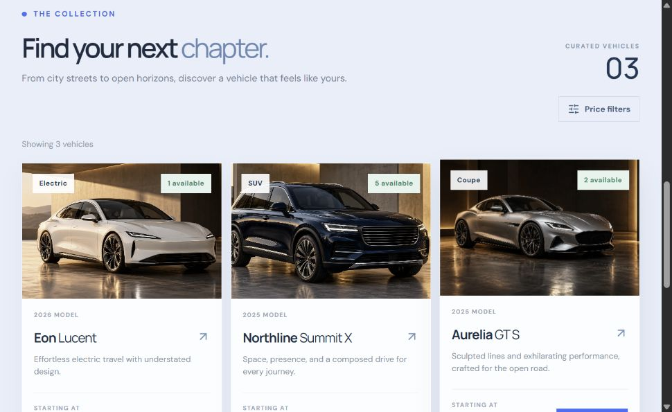
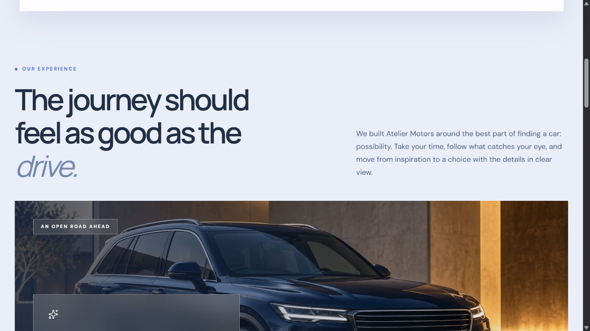

# Atelier Motors — Car Dealership Inventory System

[](https://atelier-motors-yaco.onrender.com/)
[](TEST_REPORT.md)
[](TEST_REPORT.md)
[](LICENSE)

A full-stack, test-driven car dealership inventory system with a calm, royal blue-gray showroom interface. Buyers can browse, search with real-time filters, register, log in, and purchase vehicles. Admin users have elevated controls to add, edit, delete, and restock inventory. 

The application is engineered strictly following SOLID principles, complete separation of concerns, comprehensive input validation, and a verified Test-Driven Development (TDD) Red-Green-Refactor workflow.

- **Live Deployed Application (Brownie Points):** [https://atelier-motors-yaco.onrender.com/](https://atelier-motors-yaco.onrender.com/)
- **Public Repository:** [https://github.com/Lemonseeds/atelier-motors-inventory](https://github.com/Lemonseeds/atelier-motors-inventory)
- **Test Evidence & Coverage:** [TEST_REPORT.md](TEST_REPORT.md)
- **Raw AI Chat Logs & Prompts:** [PROMPTS.md](PROMPTS.md)
- **Proposed AI Assistant Placement:** [CHATBOT_STRATEGY.md](CHATBOT_STRATEGY.md)

---

## Screenshots







---

## Architectural Stack

### Backend
- **Runtime:** Node.js 22 LTS (ES Modules)
- **Framework:** Express 5
- **Databases:**
  - **SQLite** via `better-sqlite3` with Write-Ahead Logging (`WAL`) enabled for local zero-config persistent storage.
  - **PostgreSQL** via `pg` Pool for production cloud deployments (Render).
  - Portability verified with `@electric-sql/pglite` (WebAssembly Postgres in-memory integration testing).
- **Authentication & Security:**
  - Cryptographically salted password hashing via Node.js native `scryptSync` (64-byte key length).
  - HMAC-SHA256 (`HS256`) signed stateless Bearer tokens with expiration.
  - Timing-safe equality checks (`crypto.timingSafeEqual`) on passwords and signatures to prevent timing attacks.
  - Role-based access control with server-enforced role assignments (clients cannot set own role; only designated `ADMIN_EMAIL` receives admin elevation).
- **Data Access:**
  - Repository Pattern (`repositories/vehicleRepository.js`, `repositories/userRepository.js`).
  - Atomic inventory decrement and increment (`UPDATE ... WHERE quantity > 0 RETURNING *`) eliminating race conditions and double-selling.

### Frontend
- **Framework:** React 19 Single Page Application (SPA).
- **Styling:** Tailwind CSS v4 using modern `@theme` design tokens for an opaque, royal blue-gray glassmorphic showroom aesthetic.
- **Icons:** `lucide-react`.
- **Bundler:** Vite 7.
- **Editorial content:** The Experience and About sections now explain the browsing journey, brand point of view, listing clarity, and common questions in a layered blue-gray design.

### Testing & Quality Assurance
- **Backend Suite:** Node.js native test runner (`node:test`) + `supertest` + `@electric-sql/pglite`.
- **Frontend Suite:** Vitest 3 + JSDOM + React Testing Library + `@testing-library/jest-dom`.
- **Code Coverage:** Built-in V8 code coverage collector (98.2% backend line coverage).

---

## Project Structure

```text
├── client/
│   ├── components/
│   │   ├── AuthDialog.jsx       # Sign In & Registration modal with error states
│   │   ├── Modal.jsx            # Accessible dialog backdrop with ESC listener
│   │   ├── VehicleCard.jsx      # Inventory card with stock status & admin actions
│   │   └── VehicleDialog.jsx    # Add/edit vehicle form with validation
│   ├── lib/
│   │   └── catalog.js           # Currency formatters & filter functions
│   ├── App.jsx                  # Main application layout, hero & live catalog
│   ├── main.jsx                 # Client entry point
│   └── style.css                # Tailwind CSS v4 design tokens and utility layers
├── server/
│   ├── db/
│   │   ├── index.js             # Database selector (SQLite vs PostgreSQL)
│   │   ├── sqlite.js            # SQLite driver with WAL pragma
│   │   └── postgres.js          # PostgreSQL pool adapter & parameter mapping
│   ├── repositories/
│   │   ├── userRepository.js    # User data access and duplicate email handling
│   │   └── vehicleRepository.js # Vehicle data access & atomic transaction logic
│   ├── routes/
│   │   ├── authRoutes.js        # Auth router: /register, /login, /me
│   │   └── vehicleRoutes.js     # Vehicles router: CRUD, purchase, restock
│   ├── app.js                   # Composition root & Express app factory
│   ├── auth.js                  # Token signing & scrypt hashing primitives
│   ├── index.js                 # Server bootstrapper & listener
│   ├── middleware.js            # Token authentication & admin authorization guards
│   ├── seed.js                  # Idempotent showroom inventory seeder
│   └── validation.js            # Pure validation functions returning { value, error }
├── docs/screenshots/            # UI screenshots
├── render.yaml                  # Render Blueprint for zero-friction cloud deployment
├── Dockerfile                   # Multi-stage production container
└── TEST_REPORT.md               # Complete test and coverage results
```

---

## Local Setup & Run

### Prerequisites
- Node.js 22.x or later
- npm 10.x or later

### 1. Clone & Install
```sh
git clone https://github.com/Lemonseeds/atelier-motors-inventory.git
cd atelier-motors-inventory
npm ci
```

### 2. Environment Configuration
Copy the example environment template:
```sh
cp .env.example .env
```
Key variables:
- `JWT_SECRET`: A secure random string for token signing (required in production).
- `ADMIN_EMAIL`: The email address that automatically receives `admin` privileges upon registration (e.g. `admin@example.com`).
- `PORT`: Server port (default: `3001`).
- `DATABASE_PATH`: Local SQLite path (default: `./data/inventory.db`).
- `DATABASE_URL`: (Optional) PostgreSQL connection URI for hosted cloud database.

### 3. Start Development Servers
Run both backend API and Vite client concurrently:
```sh
npm run dev
```
- Frontend: [http://localhost:5173](http://localhost:5173) (proxies `/api` calls to port 3001)
- Backend API: [http://localhost:3001](http://localhost:3001)

### 4. Running the Built Single-Server Mode
To test the production build locally:
```sh
npm run build
npm start
```
Open [http://localhost:3001](http://localhost:3001). The Express server serves both the REST API and the compiled React production bundle from `client/dist`.

### 5. Administrator Access & Credentials
The application automatically provisions a pre-configured Administrator account on boot:
- **Email:** `admin@example.com`
- **Password:** `AdminPass123!`

Click **Sign in** in the top-right navigation bar and enter these credentials (or use the one-click **"Fill demo admin"** button inside the dialog). Once signed in as an Admin:
- **`+ Add vehicle`** button appears in the collection toolbar to add new showroom cars.
- **`Edit details`** button appears on each vehicle card to update pricing, specifications, or imagery.
- **`Restock`** button appears on each vehicle card to add stock units.
- **`Delete`** button appears on each vehicle card to permanently remove vehicles.

*(Any account registered with an email matching `ADMIN_EMAIL` in `.env` automatically receives full administrator privileges.)*

---

## Running with Docker

Build and run the self-contained container:
```sh
docker build -t atelier-motors .

docker run --rm -p 3001:3001 \
  -e JWT_SECRET="replace-with-a-long-random-secret" \
  -e ADMIN_EMAIL="admin@example.com" \
  -v atelier-data:/app/data \
  atelier-motors
```
The persistent volume `atelier-data` ensures your SQLite database persists across container restarts.

---

## REST API Reference

All `/api/vehicles*` endpoints require a Bearer token in the `Authorization` header: `Authorization: Bearer <token>`.

| Method | Endpoint | Access | Purpose |
| --- | --- | --- | --- |
| `GET` | `/api/health` | Public | Service health probe |
| `POST` | `/api/auth/register` | Public | Create new account (`{ name, email, password }`) |
| `POST` | `/api/auth/login` | Public | Authenticate and receive JWT token |
| `GET` | `/api/auth/me` | Authenticated | Fetch current user profile (sanitized) |
| `GET` | `/api/vehicles` | Authenticated | List all vehicles |
| `GET` | `/api/vehicles/search` | Authenticated | Search by `q`, `make`, `model`, `category`, `minPrice`, `maxPrice` |
| `POST` | `/api/vehicles` | Authenticated | Add vehicle to catalogue |
| `PUT` | `/api/vehicles/:id` | Owner / Admin | Update vehicle details (partial update supported) |
| `DELETE` | `/api/vehicles/:id` | Admin only | Remove vehicle from catalogue |
| `POST` | `/api/vehicles/:id/purchase`| Authenticated | Purchase 1 unit (atomic; returns 409 if sold out) |
| `POST` | `/api/vehicles/:id/restock` | Admin only | Restock units (`{ quantity: <positive_integer> }`) |

---

## Testing & TDD Workflow

We followed a disciplined Test-Driven Development (Red-Green-Refactor) pattern evidenced throughout the Git commit history.

```sh
# Execute the full test suite (backend TAP tests + client Vitest tests)
npm test

# Generate backend code coverage report
npm run coverage:server

# Run client component tests
npm run test:client

# Full verification (tests + build bundle)
npm run check
```

---

## My AI Usage

In strict accordance with the kata AI usage transparency guidelines:

### Tools Used
1. **OpenAI Codex:**
   - Initial requirement analysis and planning.
   - Drafting initial backend endpoint tests and base controller logic.
2. **OpenAI ImageGen:**
   - Generating project-specific showroom automotive assets (`hero-v2.webp`, `coupe.webp`, `suv.webp`, `sedan.webp`) ensuring zero copyright infringements or borrowed assets.
3. **Google Antigravity:**
   - Auditing the solution against all PDF rules and bonus criteria.
   - Authoring strict Red-phase test suites (`server/validation.test.js`, `server/db/database.test.js`, `server/db/postgres.test.js`, and Vitest client suites).
   - Architectural refactoring: decomposing monolithic modules into pure validators, repository layers, and dedicated Express routers.
   - Integrating `@electric-sql/pglite` to test real PostgreSQL compatibility in CI without Docker dependencies.
   - Migrating custom styling into Tailwind CSS v4 `@theme` design tokens with full component isolation.
   - Configuring the Render Blueprint (`render.yaml`).

### Co-Authorship Compliance
Every commit assisted by AI includes the appropriate `Co-authored-by` trailer as specified in the kata guidelines (e.g., `Co-authored-by: OpenAI Codex <codex@openai.com>` and `Co-authored-by: Gemini <gemini-code-assist@users.noreply.github.com>`).

### Reflection
AI accelerated the speed of exploratory scaffolding, boilerplate generation, and asset creation. However, rigorous human-in-the-loop engineering was crucial:
- **Testing was paramount:** Initial AI outputs lacked comprehensive edge-case handling (such as literal wildcard escaping in SQL `LIKE` queries, case-insensitive cross-database queries, and Vitest cleanup hook returns).
- **Architecture discipline:** AI tended towards monolithic single-file implementations (`main.jsx` and `app.js`). Stepping back to enforce clean architecture (Repository Pattern, Dependency Injection, SRP) resulted in a much cleaner, maintainable codebase.

Raw prompt exchanges and conversation logs are preserved verbatim in [PROMPTS.md](PROMPTS.md).

---

## Cloud Deployment (Brownie Points)

- **Live Application URL:** [https://atelier-motors-yaco.onrender.com/](https://atelier-motors-yaco.onrender.com/)
- **API Health Check:** [https://atelier-motors-yaco.onrender.com/api/health](https://atelier-motors-yaco.onrender.com/api/health)
- **Deployment Platform:** Render (Free Web Service + Free Managed PostgreSQL Database)

The deployment is managed via the repository's **Render Blueprint** (`render.yaml`), which provisions:
1. A **Free Web Service** running the Node.js API and serving the React SPA bundle with automated restarts.
2. A **Free Managed PostgreSQL Database** providing durable cloud persistence so inventory and user accounts persist across service sleep cycles and restarts.

### How to reproduce deployment from the repository:
1. Log into your Render account at [dashboard.render.com](https://dashboard.render.com).
2. Click **New +** ➔ **Blueprint**.
3. Select this repository (`Lemonseeds/atelier-motors-inventory`).
4. Click **Apply**. Render automatically provisions the database and web service with all environment variables (`DATABASE_URL`, `JWT_SECRET`, `PORT`, `NODE_ENV`) configured.

## Authors & Contributors

- **Author:** [OpenAI Codex](https://github.com/codex) (`codex@openai.com`) — Initial project generation, test harness, and baseline inventory API implementation.
- **Contributors:**
  - [Lemonseeds](https://github.com/Lemonseeds) (`ayrtonjoep@gmail.com`) — Project owner, architecture direction, code review, cloud deployment, and verification.
  - [Gemini / Antigravity](https://github.com/gemini-code-assist) (`gemini-code-assist@users.noreply.github.com`) — Deep architecture audit, PostgreSQL integration via PGlite, frontend modularization into React components, Tailwind CSS v4 design system refactoring, comprehensive test suites, and Render deployment automation.

